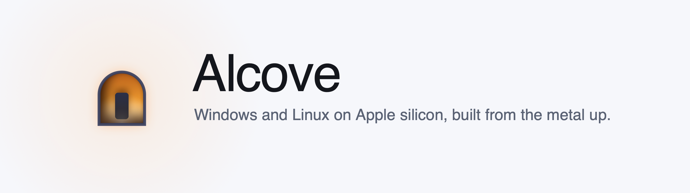
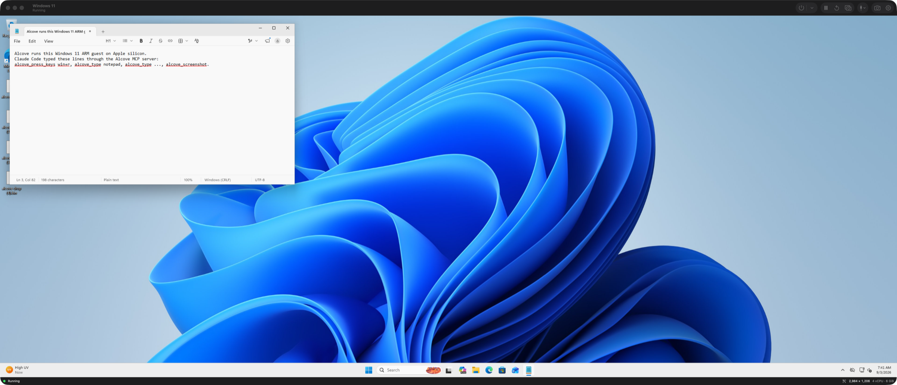
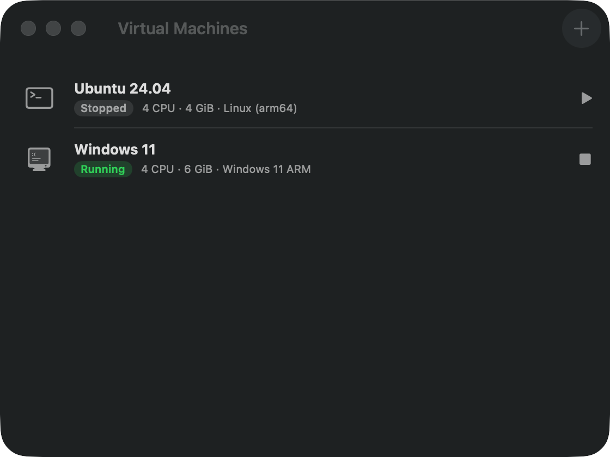

<div align="center">

<picture>
  <source media="(prefers-color-scheme: dark)" srcset="docs/assets/banner-dark.png">
  
</picture>

<p>
  <a href="#quick-start"></a>
  <a href="https://github.com/YangTaeyoung/alcove/actions/workflows/ci.yml"></a>
  <a href="LICENSE"></a>
  <a href="#automate-it-from-claude-code"></a>
</p>

<p><b>A virtual machine app for the Mac, written from scratch on top of QEMU and Apple's Hypervisor framework —<br>and the first one your coding agent can drive by itself.</b></p>

</div>

---

Alcove runs Windows 11 ARM and Linux on Apple silicon. QEMU does the CPU and
device emulation; everything you touch above it is this repository: the app,
the display path, the guest tools, the automation API, and an MCP server so
Claude Code can take a screenshot, click a button, type, and run PowerShell
inside the guest.

<div align="center">
  
  <br><sub>Windows 11 ARM in an Alcove window. The text in Notepad was typed by Claude Code through the MCP server.</sub>
  <br><br>
  
  <br><sub>Your machines, their state, one click to start.</sub>
</div>

## Why another VM app

Because the interesting part is not running a guest — it is what an agent can
do with one. Alcove exposes every running VM through a local socket and an MCP
server, so an assistant can test a Windows build, click through an installer,
or read a log inside the guest, without a human moving the mouse.

The rest is what you would expect, done properly: near-native ARM guests
through Apple's hypervisor, snapshots, suspend to disk, USB passthrough,
clipboard and file sharing.

## Features

| | |
|---|---|
| **Windows 11 ARM and Linux** | Apple silicon guests at near-native speed through `-accel hvf`. Unattended Windows install included. |
| **Our own display path** | A QEMU display backend written for this project shares the framebuffer through memory; the app draws it with Metal and sends input back over a unix socket. |
| **Guest tools** | A small Go agent for Windows and Linux: clipboard both ways, file drop, shell commands and background jobs, processes, file access, display modes that follow the window. |
| **Snapshots and suspend** | qcow2 snapshots with VM state, plus suspend-to-disk that resumes where you left off. |
| **USB passthrough** | Hot-plug host USB devices into a running guest. |
| **Agent automation** | A documented control protocol and an MCP server: screenshot, click, drag, scroll, type, key combos, shell commands and background jobs, processes, clipboard, file push, pull and folder sync, guest file read and write. |
| **No black boxes** | The engine is a pinned QEMU tag plus one readable patch. Build it yourself in one command. |

Tested on an M3 Pro running macOS 26 with Windows 11 Pro ARM 25H2 and Ubuntu
24.04 arm64 guests.

## Quick start

```bash
brew install meson pkgconf ninja glib pixman dtc libslirp capstone libusb zstd swtpm xcodegen go
git clone git@github.com:YangTaeyoung/alcove.git && cd alcove

scripts/build-qemu.sh              # QEMU 11.1.1 + the Alcove display backend
xcodegen generate                  # generate Alcove.xcodeproj
xcodebuild -project Alcove.xcodeproj -scheme Alcove build
```

Then open the app, press **+**, pick a guest OS and an ISO. For Windows you
need an ARM64 ISO from Microsoft — `scripts/fetch-windows-iso.sh` finds the
right SKU and tells you where to download it.

Prefer the command line?

```bash
cd AlcoveKit && swift build --product alcovectl
.build/debug/alcovectl create --name "Ubuntu" --os linux --iso ~/Downloads/ubuntu.iso
.build/debug/alcovectl run "Ubuntu"
```

## Automate it from Claude Code

```bash
cd mcp && npm install && npm run build
claude mcp add alcove -- node "$PWD/dist/index.js"
```

That is it. The MCP server talks to the app when it is running and starts a
headless engine when it is not.

```
> Start the Windows VM, open Notepad and type a note, then show me the screen.

  alcove_start_vm    Windows 11: running; guest tools connected
  alcove_press_keys  pressed win+r
  alcove_type        typed 8 characters
  alcove_screenshot  1440x900 guest pixels
```

<details>
<summary><b>All 29 tools</b></summary>

| Toolset | Tool | What it does |
|---|---|---|
| `core` | `alcove_list_vms` | Every VM with state and screen size |
| `core` | `alcove_vm_status` | One VM, including whether the guest tools are connected |
| `core` | `alcove_start_vm` / `alcove_stop_vm` | Boot (waiting for the tools) or shut down |
| `core` | `alcove_screenshot` | The guest screen as an image, downscaled to save tokens |
| `core` | `alcove_click` / `alcove_move_mouse` / `alcove_drag` / `alcove_scroll` | Pointer, in guest pixels |
| `core` | `alcove_type` / `alcove_press_keys` | Text and combos like `ctrl+alt+delete`, `win+r` |
| `core` | `alcove_exec` | A command in PowerShell, `cmd` or `sh`, or a program by `argv`, with working directory, environment, stdin and timeout; returns exit code, stdout and stderr |
| `core` | `alcove_get_clipboard` / `alcove_set_clipboard` | Clipboard both ways |
| `core` | `alcove_push_file` | Copy a file from the Mac into the guest, to the Desktop or to an exact path |
| `core` | `alcove_wait_idle` | Wait until the screen stops changing |
| `shell` | `alcove_exec_start` | Start a build, test run or server as a background job |
| `shell` | `alcove_exec_read` / `alcove_exec_write` | Follow a job's output by offset; write to its stdin |
| `shell` | `alcove_exec_kill` / `alcove_exec_list` | Stop a job with its process tree; list jobs and exit codes |
| `shell` | `alcove_process_list` / `alcove_process_kill` | Guest processes by name; kill by pid or name |
| `files` | `alcove_pull_file` | Copy a file from the guest to the Mac |
| `files` | `alcove_sync_dir` | Send the changed files of a Mac folder into a guest folder |
| `files` | `alcove_fs_list` / `alcove_fs_read` / `alcove_fs_write` / `alcove_fs_delete` | List a guest folder; read a text file by range or its last lines; write text; delete |

</details>

The server lists every toolset by default. `ALCOVE_MCP_TOOLSETS` selects some,
for example `core` for the 16 screen and input tools only:

```bash
claude mcp add alcove -e ALCOVE_MCP_TOOLSETS=core,files -- node "$PWD/dist/index.js"
```

## How it works

```
┌──────────────────────────────────────────────────────────┐
│  Alcove.app          SwiftUI · AppKit · Metal            │
│  library · VM windows · settings · snapshots · USB       │
├───────────────┬──────────────────────┬───────────────────┤
│  AlcoveKit    │  AlcoveControl       │  alcove-mcp       │
│  engine, QMP, │  automation API      │  MCP server       │
│  display, VMs │  over a unix socket  │  (TypeScript)     │
├───────────────┴──────────────────────┴───────────────────┤
│  qemu-system-aarch64        our ui/alcove.c backend      │
│  shared-memory framebuffer · JSON input · QMP control    │
├──────────────────────────────────────────────────────────┤
│  Hypervisor.framework                       macOS        │
└──────────────────────────────────────────────────────────┘
        ▲                                    ▲
        │ TCP over user-mode networking      │
   alcove-agent (Go, in the guest): clipboard, files, shell, display modes
```

One QEMU process per VM, spawned by the app and never linked into it. The app
talks to it over three channels: a display socket with a shared-memory
framebuffer, QMP for control, and the guest agent for anything only the guest
can do.

| Document | What is in it |
|---|---|
| [`docs/display-protocol.md`](docs/display-protocol.md) | The wire format between QEMU's `alcove` display backend and the app |
| [`docs/control-protocol.md`](docs/control-protocol.md) | The automation API: screenshots, input, commands and jobs, processes, files |
| [`docs/agent-protocol.md`](docs/agent-protocol.md) | The guest agent protocol: SMBIOS token handshake, messages, and the request/response operations |
| [`docs/superpowers/specs/`](docs/superpowers/specs) | The design, and why each choice was made |
| [`docs/research/`](docs/research) | Verified notes on QEMU 11.1.1 internals, with citations |

## Repository layout

```
Alcove/          the macOS app
AlcoveKit/       Swift package: display protocol, QMP, engine, agent client,
                 control API, and the alcovectl command line tool
qemu-patches/    the display backend patch, applied to a pinned QEMU tag
guest-tools/     the Go agent that runs inside Windows and Linux guests
mcp/             the MCP server
scripts/         engine build, unattended Windows install, test harnesses
docs/            protocols, design, research notes
```

## Testing

```bash
scripts/test/all.sh                       # everything below, in order
scripts/build-qemu.sh                     # engine
python3 scripts/test/display-backend.py   # boots EDK2 only and drives the display protocol
(cd AlcoveKit && swift test)              # 171 tests; VM tests boot the real engine
(cd guest-tools && go test ./...)         # guest agent
(cd mcp && npm run build && npm test)     # MCP server helpers
python3 scripts/test/mcp-smoke.py --list-only
```

With a Windows guest available, `scripts/test/agent-windows.py` and
`scripts/test/mcp-smoke.py --vm "Windows 11"` exercise the whole chain against
a real desktop: clipboard round trip, file push with a checksum, typing into
Notepad and reading it back.

The shell, process and file operations have their own run against a running
Windows guest:

```bash
python3 scripts/test/install-agent.py       # copies the built agent in, installs it with --allow-exec, checks hello
python3 scripts/test/agent-rpc-windows.py   # agent operations on the forwarded agent port
python3 scripts/test/at1-e2e.py             # control socket -> agent -> guest, and MCP server -> control socket
```

`scripts/test/alcove_ctl.py` is the control-socket client these scripts import;
`scripts/test/ctl.py OP key=value ...` is its command line.

## Status

Working today: Windows 11 ARM and Linux guests, snapshots, suspend, USB
passthrough, guest tools, and the full automation surface. TPM is off by
default because `tpm-tis-device` fails under HVF on Apple silicon; Windows 11
installs without it.

Next: Coherence-style windows, GPU acceleration for the guest, and a signed,
notarised release. Plans live in [`docs/superpowers/plans/`](docs/superpowers/plans).

## Licence

The app and everything around it are MIT ([`LICENSE`](LICENSE)). The QEMU patch
series is GPL, because QEMU is — see [`NOTICE.md`](NOTICE.md) for the split and
[`qemu-patches/LICENSE`](qemu-patches/LICENSE) for the terms. Alcove runs QEMU
as a separate process and never links it.

Windows is licensed by Microsoft; bring your own. Contributions are welcome —
start with [`CONTRIBUTING.md`](CONTRIBUTING.md).
